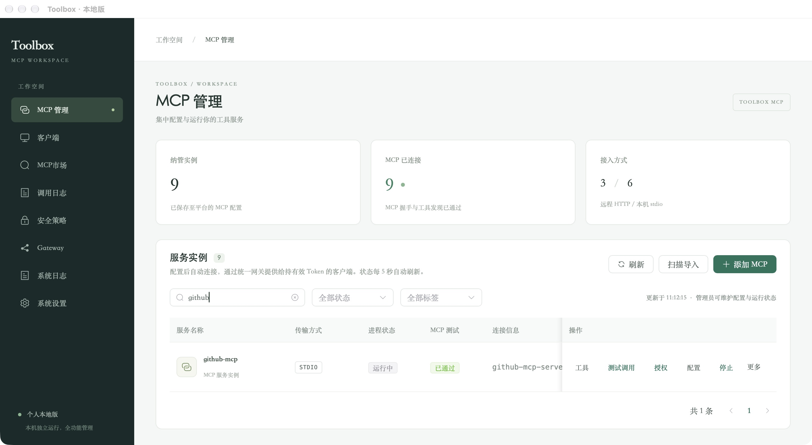
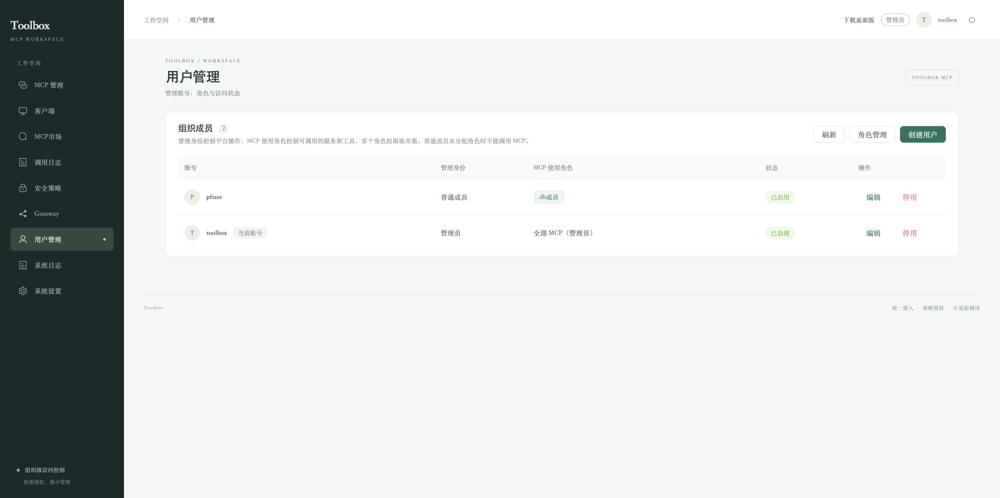
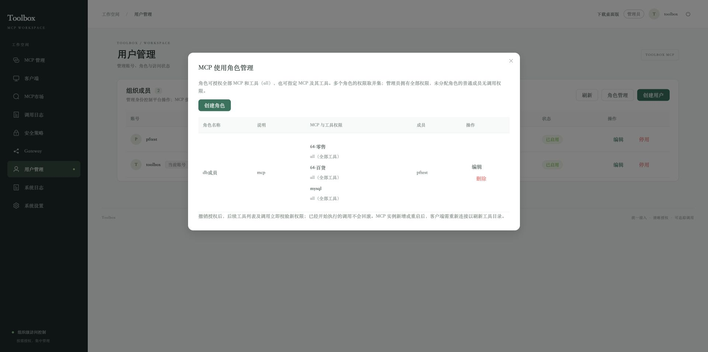

# Toolbox

Go + Vue 3 构建的 MCP 管理平台，提供个人桌面版与企业 Web 版，共用 MCP 管理与 Gateway 核心。当前源码版本为 **0.1.11**。

## 主要功能

- MCP 配置、JSON 编辑、本机扫描、批量纳管与实例复制。
- stdio / Streamable HTTP 接入，统一 Gateway、连接健康检查和会话恢复。
- 企业用户、角色、工具权限、客户端 Token 和来源 IP 策略。
- MCP 市场、多目录源、在线安装和 ZIP / TAR / TAR.GZ / TGZ 离线安装。
- 标准 HTTP MCP OAuth 浏览器授权、加密凭据与刷新。
- 调用日志、最近 7 天运行/异常日志、SQLite 备份恢复和软件包版本管理。

## 个人版与企业 Web 版

个人版适合在自己的电脑上独立使用；企业 Web 版适合将 MCP 部署在服务器上，由管理员为团队分配访问权限。两者共用 MCP 管理和 Gateway 核心，数据独立保存。

| 能力 | 个人桌面版 | 企业 Web 版 |
| --- | --- | --- |
| 登录与管理身份 | 免登录，默认本机管理员 | 账号登录，区分管理员与普通成员 |
| 用户与角色管理 | 无用户管理、角色分配入口 | 管理员创建、停用用户，维护 MCP 使用角色并分配成员 |
| MCP / 工具使用权限 | 默认可使用本机全部 MCP 和工具 | RBAC 角色授权：全部、指定 MCP 的全部工具、指定 MCP 的指定工具 |
| 管理操作权限 | 本机管理员维护全部配置 | 管理员维护 MCP、用户、角色、系统设置；普通成员使用获授权工具 |
| Gateway 客户端认证 | 每个客户端使用独立 Token，默认可访问全部 MCP 和工具 | Token 绑定所属用户，按该用户当前角色校验工具列表与实际调用 |
| Token 有效期 | 支持到期时间、永久有效和撤销 | 同样支持；停用用户或调整角色后，后续访问按新权限校验 |
| 来源 IP 策略 | 支持全局 IP / CIDR 允许与禁止规则 | 同样支持，与用户角色、Token 校验共同生效 |
| 调用日志与归属 | 查看本机调用，按客户端 / Token 区分 | 普通成员查看自己的调用；管理员查看全量并按用户、客户端、Token 筛选 |
| 软件包分发管理 | 使用桌面应用，支持本机开机启动设置 | 管理员上传、发布和管理版本包，提供桌面版下载，包目录可配置 |

企业版将**管理身份**与**MCP 使用角色**分开：管理员拥有全部 MCP 使用权限；普通成员未分配角色时无调用权限，分配多个角色时取权限并集。全局 `all` 包含以后新增的 MCP 和工具；指定 MCP 的 `all` 包含该服务以后新增的工具；指定工具只授权所选工具名称。权限由服务端校验，既影响工具发现，也限制直接调用。

角色控制的是 Toolbox 中的服务和工具访问范围。上游数据库、GitHub 等服务仍使用对应 MCP 实例配置或授权的账号；成员访问同一实例时使用该实例的上游账号，需要不同资源权限时应分别配置实例和凭据。

## 功能截图

### 个人版：本机 MCP 管理

免登录管理本机服务，支持扫描导入、添加与复制配置、连接状态检查、测试调用和调用前授权。下图为实际运行的 GitHub MCP 实例。



### 企业版：用户管理

区分管理员与普通成员，为成员分配 MCP 使用角色，并管理账号启用状态。



### 企业版：MCP 角色权限

为角色分配服务及工具范围。下图展示已保存的数据库服务授权，服务内 `all` 表示允许使用该 MCP 的全部工具。



## 目录

| 目录 | 内容 |
| --- | --- |
| `code/backend` | Go 服务、桌面宿主、MCP Gateway 与 SQLite |
| `code/web` | Vue 3 页面、静态资源和 Wails 桥接代码 |
| `code/desktop` | 桌面版本信息、图标、系统构建资源 |
| `code/scripts` | Web、服务端与桌面构建脚本 |
| `code/config` | 不含凭据的企业服务配置示例 |
| `code/docs` | 功能接口说明 |
| `doc` | 个人版、企业 Web 版使用手册 |

## 从源码构建

需要 Go **1.25.2 或兼容版本**、Node.js **22.12+ 的 22 LTS 版本**、npm、Python 3。桌面构建另需目标平台 SDK，见 [桌面构建说明](code/desktop/README.md)。

```bash
cd code
./scripts/build-native.sh
# Linux x86-64 服务端交叉编译
./scripts/build-native.sh linux-amd64
# 当前系统桌面版
./scripts/build-desktop.sh native
# Windows 11 x64 桌面版
./scripts/build-desktop.sh windows-amd64
```

Go 不在 PATH 时，可设置 `TOOLBOX_GO_BIN=/path/to/go`。脚本使用锁文件安装前端依赖，将页面嵌入 Go 可执行程序。构建时需要联网获取依赖。生成物不提交源码仓库。

服务端产物位于 `code/dist/`，桌面产物位于 `code/desktop/build/bin/` 和 `code/dist/desktop/`。本快照不包含已有安装包、依赖缓存或运行数据。

## 运行

个人版打开构建出的桌面应用，默认本机管理员、免登录，数据与企业版独立。

企业服务可复制 `code/config/toolbox.example.json` 为私有的 `toolbox.json`，按 [企业手册](doc/Toolbox企业Web版使用手册.md) 配置后运行服务端。默认回环端口 8090；启动参数以程序 `--help` 为准。远程部署所需 TLS、来源 IP 限制与初始化流程见手册。

首次启动自动生成缺失的服务器密钥；已有数据库必须继续使用原主密钥。本机空数据库的初始账号为 `toolbox`，初始密码 `toolbox@2026`，首次登录强制改密；它是产品引导凭据，不是本仓库附带的真实账户。个人版不使用该登录入口。

## 使用手册

- [个人版使用手册](doc/Toolbox个人版使用手册.md)
- [企业 Web 版使用手册](doc/Toolbox企业Web版使用手册.md)

## 许可证

本项目原创代码采用 [GNU AGPL v3.0 only](LICENSE)（`AGPL-3.0-only`）。第三方组件保留各自许可证及版权声明，详见 [第三方声明](THIRD_PARTY_NOTICES.md)。
